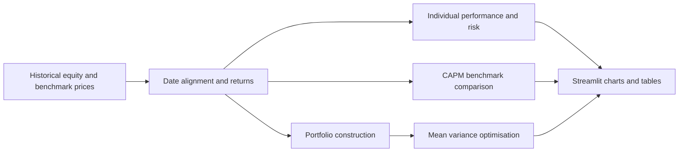

# Stock Market Performance and Portfolio Risk Analysis

> A Python quantitative-finance case study examining long-term equity returns, risk-adjusted performance, portfolio optimisation and technical indicators, with an interactive Streamlit dashboard.

**Research universe:** Apple (AAPL), Microsoft (MSFT), Alphabet (GOOGL) and Amazon (AMZN), with selected analysis covering approximately 2004 to 2024.  
**Methods:** Returns analysis, drawdown, Sharpe and Sortino ratios, CAPM, Markowitz optimisation and technical indicators.

## Executive Summary

Investors and financial analysts must compare assets on more than absolute returns. Historical performance, volatility, downside risk, market sensitivity and portfolio concentration all affect investment decisions. This project investigates those relationships using technology equities and market benchmark data.

The repository contains a research notebook and `app.py`, an interactive Streamlit dashboard with configurable stocks, date ranges, benchmarks and risk-free rates. The analysis is historical and exploratory; it is not a validated live investment strategy.

## Business Questions

1. Which stocks produced the strongest historical growth and how volatile were the returns?
2. How do risk-adjusted and downside-risk measures change the comparison?
3. How sensitive are individual assets to the chosen equity benchmark?
4. How do equal-weight and optimised portfolio allocations compare?
5. What do technical indicators reveal about historical price and momentum patterns?

## Data and Analytical Workflow

Historical prices are retrieved with `yfinance`. The dashboard uses `auto_adjust=True` and downloads adjusted close-price series. It offers a default four-stock comparison and supports additional stocks and benchmarks.



## Selected Historical Findings

The previous project analysis reports large cumulative gains for the four companies and illustrates the effect of different portfolio allocations. These figures are retained in the [archived README](docs/readme-history.md) rather than presented as independently confirmed results here.

**Verification required:** The prior README gives conflicting equal-weight cumulative return figures (1,735.27% and 3,429.9%) and unusually small or negative CAPM beta estimates for large US technology equities. Portfolio metrics, benchmark coverage, return conventions, alpha units and optimisation timing should be recalculated consistently before relying on a headline performance table.

These concerns do not invalidate the value of the underlying quantitative workflow, but they prevent unsupported claims that the optimised portfolio decisively outperformed an investable baseline.

## Methodology

### Historical return analysis

The analysis computes periodic returns from adjusted prices and compares cumulative growth, annualised performance and volatility. It also investigates distribution shape, including skewness and kurtosis. High excess kurtosis suggests a need to consider tail risk beyond normal-distribution assumptions.

### Risk-adjusted performance

Sharpe and Sortino ratios compare return with total and downside variability, while maximum drawdown captures the largest observed peak-to-trough loss. All comparisons must use consistent risk-free-rate frequency, price adjustments and return sampling.

### CAPM and benchmark analysis

A market model estimates beta and intercept terms relative to a benchmark. Beta should use consistently aligned excess-return series; intercept units and annualisation need explicit explanation. Alpha and beta from this project should be independently reproduced before publication as established empirical findings.

### Portfolio optimisation

An equal-weight baseline provides a comparison with a long-only mean-variance model implemented using PyPortfolioOpt. Optimised weights fitted and assessed on the same historical period are **in-sample results**, not evidence of future or out-of-sample performance.

### Technical analysis

The notebook and dashboard explore moving averages, Bollinger Bands, RSI and MACD. These indicators describe historical price behaviour and are not independently validated trading signals.

## Dashboard

The Streamlit application provides five areas:

| View | Analysis |
| --- | --- |
| Stock performance | Normalised prices and summary returns |
| Returns analysis | Return distributions, rolling volatility and annual patterns |
| Risk metrics | Benchmark comparison and risk indicators |
| Portfolio optimiser | Efficient frontier and allocation comparisons |
| Technical analysis | Price indicators, momentum and volume |

The dashboard supports additional selectable tickers beyond the original four-stock research universe.

## Getting Started

```bash
git clone https://github.com/TeslimAdeyanju/Stock-Market-Analysis.git
cd Stock-Market-Analysis
python3 -m venv .venv
source .venv/bin/activate
python -m pip install -r requirements.txt
streamlit run app.py
```

Requires internet access for price retrieval and compatible provider data. The commands have not been independently executed for this README revision.

## Repository Structure

```text
app.py
requirements.txt
Portfolio-Stock-Market-Analysis-of-Tech-Giants-Using-Python.ipynb
README.md
docs/
    readme-history.md
```

## Validation and Limitations

- **Survivorship bias:** The selected companies are notable historical winners.
- **In-sample optimisation:** Optimisation and comparison using the same returns can overstate strategy quality.
- **Parameter sensitivity:** Weights can change sharply when expected return estimates change.
- **Data conventions:** Split and dividend adjustments, missing trading days and benchmark alignment can affect results.
- **Trading assumptions:** Costs, slippage, turnover and taxes are not fully represented.
- **Risk:** Fat-tailed returns and concentration may be poorly captured by a single risk metric.
- **Reproducibility:** Published historical metric tables require consistent recalculation before being treated as verified.

## Next Steps

Recalculate the benchmark-aligned historical results, add a reproducible metrics table, implement rolling out-of-sample portfolio comparisons, quantify turnover and costs, and include a genuine dashboard screenshot. Broader multi-asset diversification and factor analysis are potential extensions rather than established outcomes.

## Author and References

**Teslim Adeyanju**  
[Portfolio](https://adeyanjuteslim.co.uk) | [LinkedIn](https://www.linkedin.com/in/adeyanjuteslimuthman)

Research foundations: Markowitz (1952), Sharpe (1966) and CAPM-related portfolio theory. See the [previous README](docs/readme-history.md) for full historical tables and references.
